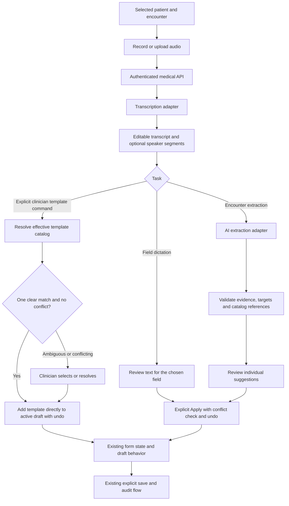

# Medical voice assistant architecture

Status: proposed architecture, reviewed against current working-tree sources on 2026-10-10. Model selection, application implementation, schema changes, and deployment are later steps.

## 1. Purpose and scope

Help a clinician capture spoken information and place reviewed content in its existing clinical destination. Support individual text-field dictation, longer doctor dictation, and doctor/patient conversations. The assistant prepares suggestions; the clinician chooses what enters the form and uses its established save flow.

The original workflow agreement remains the baseline: provide an assistant option beside applicable text fields; review extracted clinical information field by field; allow an explicit spoken command naming one unambiguous existing template to add its contents directly to the active draft with undo. Ambiguous matches require clinician selection. Final clinical saving remains the clinician's explicit action.

AI-generated medical suggestions, if introduced later, are a separate capability and visibly separate from transcribed clinician instructions or patient statements. They never silently enter the diagnosis, treatment, or decision fields. The extraction module in this architecture organizes stated information; it does not generate clinical recommendations.

The first implementation slice should prove one clinical form and one target field end to end. The architecture covers the full intended workflow so that the first slice does not require a different persistence or permission model later.

Patient identity, encounter selection, author identity, and permissions come from SELRS. Spoken names do not select or switch a patient. External doctor portal and KF integration require their own verified adapters; neither is implicitly covered by a medical patient ID.

## 2. Existing code and implications

| Source | Verified behavior | Architectural consequence |
| --- | --- | --- |
| `server/_core/voiceTranscription.ts` | Fetches an audio URL, buffers it, checks a 16 MB limit afterward, sends `whisper-1` through Forge, and returns Whisper-shaped output. Source search found no application call sites. | This is a helper, not an integrated voice feature. Reuse is conditional on model selection; do not expose its arbitrary audio-URL fetch as the new interface. |
| `server/_core/llm.ts` | `invokeLLM` supports structured response formats but hardcodes `gemini-2.5-flash` through Forge. Source search found no application invocations. | Existing types may inform the adapter. The hardcoded provider/model is not an architecture decision. |
| `server/routers/medical.ts` | Composes medical sub-routers; no voice procedures are composed. | Add a medical-owned sub-router later, preserving the established tRPC API style. |
| `client/src/pages/WritePrescription.tsx` | Holds diagnosis, notes, and medication items; debounces `savePatientPageState` at 800 ms. Explicit save calls `createPrescriptionWithItems`. | Suggestions must live outside these states until Apply. Applied content may enter the existing draft save before final prescription creation. |
| `client/src/pages/RequestTests.tsx` | Holds diagnosis, notes, and selected tests; debounces page-state saves at 800 ms. Explicit save calls `createTestRequest`. | Same review isolation rule. Diagnosis is not a parameter of the final test-request mutation. |
| Both template handlers | `handleApplyReadyPrescription` and `handleApplyReadyTestTemplate` replace their respective arrays. Overrides and built-in templates are combined for display. | Voice template additions need a separate additive operation against the effective template catalog. Reusing the replace handlers would discard existing entries. |
| `client/src/pages/LasikExamSheet.tsx` | `saveSheetEntry` stores diagnosis/decision and other sheet content; selected visit complaint is updated separately through `updateVisitChiefComplaint`. | Mapping must be sheet-specific and encounter-aware; do not introduce a universal clinical-note save. |
| `client/src/pages/SpecialistSheet.tsx` | Uses a `finalDecision` field, unlike LASIK's `finalDecisionText`. | Target identifiers are supplied by the form adapter, not invented by the model. |
| `client/src/hooks/examination/useExaminationForm.ts` | Integrates patient, examination, checklist, sheet, and workflow state through several existing mutations. | Avoid mounting a second persistence pipeline inside the assistant. |
| `scripts/stt-compare.mjs` | Existing local transcription comparison utility. | Review/update its candidates and scoring in the transcription-selection stage; its existence proves no clinical accuracy. |

## 3. Processing sequence

Field dictation can operate without the extraction model. Encounter extraction consumes a reviewed transcript. Editing that transcript invalidates its existing extraction results until extraction runs again. Conversation mode requires speaker-aware review; anonymous speaker labels are not proof of who is the clinician. Direct template addition is a separate path for explicit clinician commands, not an action inferred from incidental conversation or a patient mentioning a template. An uncertain transcript or speaker attribution requires review before treating speech as a command.

## 4. Modules and interfaces

| Module | Responsibility | Interface result |
| --- | --- | --- |
| Capture | Microphone lifecycle, upload, elapsed duration, supported format selection, stop/cancel, cleanup. | Audio plus MIME type and capture metadata. |
| Assistant session | Bind requests and responses to user, patient domain/ID, selected encounter, form, session ID, and transcript revision. | Current stage and its review data. |
| Medical API | Authentication, target authorization, input limits, rate/concurrency limits, cancellation/deadlines, catalog access. | Validated transcription or suggestion result. |
| Transcription adapter | Convert approved audio input to a stable transcript shape. | Text, language when available, segments and timing/speaker labels when available, actual provider/model metadata. |
| Extraction adapter | Read transcript and allowed targets; return grounded candidate content and requested template names. | Structured candidates with transcript evidence and explicit uncertainty. |
| Validation and resolution | Validate shape, evidence references, permitted targets, existing catalog IDs, ambiguous matches and duplicate additions. | Reviewable suggestions or actionable validation failures. |
| Form adapter | Read current target values; apply reviewed clinical patches or validated explicit template commands through the form's state operations. | Changed fields/items, previous values, and an undo record. |

Keep provider configuration behind the transcription and extraction interfaces. A provider comparison harness can call the same interface as production. Do not build a general agent framework, autonomous tool loop, or separate microservice for this workflow.

## 5. Proposed contracts

These are contract requirements, not implemented TypeScript types.

- Context: patient domain (`medical` initially), patient ID, optional verified visit ID, form kind, session ID, request ID, and transcript revision. The backend derives user identity from authentication. It verifies patient/visit association and whether the form requires an encounter.
- Target descriptor: stable adapter-owned target ID, text/item/template kind, allowed operations, eye side where applicable, and any format constraint. Only registered, authorized targets can receive suggestions.
- Transcript: text and revision, optional segments with IDs/time spans/anonymous speaker labels, provider/model identity, and explicit capability flags. Missing segments or speaker labels remain missing, not fabricated.
- Suggestion: stable ID, allowed target ID, proposed value or operation, supporting transcript quote/range, speaker attribution when available, and review flags such as ambiguous name, missing dosage, unclear eye side, contradiction, or negation.
- Template request: prescription/test scope, explicit add intent, spoken name and supporting transcript span. Resolve to the effective catalog; return one valid candidate, multiple candidates, or no match. Only one clear match from a verified clinician command is eligible for direct draft addition; uncertainty and conflicts require review.
- Apply record: session/context/revision, suggestion IDs, affected target values before/after, and form revision. This record supports undo within the current form session.

Use runtime schemas on requests, normalized provider output, and final suggestions. Evidence must refer to the exact transcript revision. No calibrated confidence percentage is displayed unless its meaning is established during evaluation.

## 6. Clinical destinations

| Information | Existing destination | Apply/save rule |
| --- | --- | --- |
| Complaint | Visit `chiefComplaint`; LASIK form `consultantExam.complains` | Select a valid visit; let its host save flow update the visit. |
| Diagnosis | Host sheet's actual diagnosis field, such as `diagnosisText`; prescription/test page also has its own `diagnosis` draft | Never assume page draft diagnosis equals a normalized diagnosis record. Apply only to a mapped target. |
| Decision | LASIK `finalDecisionText`, specialist `finalDecision` | Route through the active sheet adapter and `saveSheetEntry`. |
| Treatment/medication | Active sheet treatment fields or prescription item fields | Preserve dictated dose, frequency, duration and instructions; unspecified values remain empty and flagged. |
| Tests/imaging | Existing selected-test catalog and `createTestRequest` items | Use valid test IDs, keep imaging category/laterality where the destination supports it. |
| Notes | Host form's actual notes field | No automatic fallback that dumps all unassigned content into notes. |
| Named templates | Effective built-in plus override catalog | One clear, explicit clinician command adds the stored contents directly to the active draft with undo. Ambiguous matches require selection; duplicate/conflicting entries require resolution. Preserve existing items and saved template doses/instructions. Voice does not edit template definitions. |

Target registration is explicit per form. Physical measurements, checkbox history, and every additional sheet field require their own verified mapping and validation before being enabled. Unmapped content remains visible for manual handling.

## 7. Review, Apply and Undo

1. Display transcription separately from clinical form state; allow correction before extraction.
2. Show each suggestion with its target and source evidence. Missing, negated, hypothetical, historical, and patient-reported statements remain distinct.
3. Let the clinician edit, select, exclude, or resolve a candidate. A patient statement alone does not become a clinician diagnosis or order.
4. Apply only selected clinical suggestions. Text defaults to a previewed append/merge; replacing existing text requires an explicit operation. For an explicit clinician template command with one clear match, add its stored items directly to the active draft and show what was added with Undo. Preserve existing entries and template doses/instructions. Ambiguous names, uncertain recognition, duplicate items, and conflicting strengths/doses require resolution before addition. Repeated delivery of the same command does not add items twice.
5. Compare context and relevant current values against the apply snapshot. If the clinician edited a field in the meantime, show the conflict rather than overwrite it.
6. Undo restores only the assistant's affected values if they still match the recorded after-values. Later manual edits cause a review conflict. Clear undo on context change or final save; this is not a reversal of persisted medical records.
7. Preserve existing saves. Where existing forms autosave drafts, explain that applied content joins that behavior. Raw transcript and unreviewed suggestions never join the draft payload.

Cross-form distribution is staged: keep reviewed candidates grouped by destination and open/apply them through that destination's form adapter. Initially only mounted, verified adapters accept changes. Global application across unmounted forms needs a separately specified draft handoff; do not write those clinical tables directly from the extraction API.

## 8. Lifecycle and processing limits

Clinical extraction sequence: idle -> recording/upload-ready -> transcribing -> transcript-review -> extracting (optional) -> suggestion-review -> applied-to-form. Explicit template-command sequence: transcribing -> command/catalog validation -> added-to-draft, or match/conflict review when needed. Both paths retain Undo and the existing explicit clinical save. Each processing stage can fail, be cancelled, or retry independently. Cancellation discards subsequent responses even if a provider cannot cancel its upstream work.

Starting a new patient/encounter/form session invalidates prior responses, suggested patches, and undo. Stop microphone tracks and revoke preview object URLs on cancel/unmount. A late response never changes the new patient's form.

First slice: bounded, stop-then-process requests using tRPC and an encoded audio payload. Set a conservative decoded size/duration limit below existing proxy/server limits; validate before provider dispatch and do not place audio in URLs. Numeric limits depend on model/format testing in the next stage. Larger conversations should use bounded ordered segments with overlap and evidence-preserving reconciliation once evaluated. If resumable processing is necessary, specify an authorized temporary upload and job lifecycle before adding it; do not imply long conversations fit a synchronous request.

No automatic fallback to a clinically unevaluated model. Preserve the transcript when extraction fails so the clinician can still use dictation. Return a useful failure when audio is empty, silent, unsupported, too large, or a provider result is invalid.

## 9. Permissions and data lifecycle

- Initial clinical extraction is clinician-only: doctor/admin/manager authorization plus the same page/patient/branch restrictions required by its host workflow. Existing `medicalStaffProcedure` alone is broader and does not establish the intended new gate. Wider staff field dictation is a separately mapped capability.
- External portal authentication and KF patient IDs remain separate from medical staff sessions. Reject unsupported domains and targets.
- Record only after an explicit user action; use the appropriate recording consent flow for conversations. Keep a clear recording indicator.
- Credentials and provider calls stay on the backend. Clinical text is treated as input data, including spoken instructions that attempt to alter the extraction task.
- Proposed initial retention: audio stays in browser memory until processing/discard and server memory during processing. Transcript/suggestions stay in the active assistant session. Reload loses that session. No new audio archive, transcript table, S3 upload, or database migration for the first slice.
- Provider retention/data-use terms are a model-selection check; local deletion does not establish provider deletion. Persistent transcript/audio retention requires a separate explicit product policy.
- Operational logs contain stage, request identifier, duration, result code, and actual usage when available; no audio, transcript, patient names, or medication content. Existing medical saves retain their established audit behavior. Draft/transcript provenance is not promised as a durable audit feature until its storage contract is designed.

## 10. Proposed code placement

- `shared/medical-assistant.ts`: request/result schemas and allowed target identifiers.
- `server/routers/medical-assistant.ts`: medical-owned transcription/extraction procedures, composed by `server/routers/medical.ts`.
- `server/services/medical-assistant/`: processing, provider adapters, evidence validation, and catalog resolution. Choose only the necessary files after the models are selected.
- `client/src/features/medical-assistant/`: recording/review modules, session state and form adapters.
- Existing clinical forms: narrowly scoped assistant entry points and state integration. Existing API save paths remain authoritative.

## 11. Architecture completion and next stages

The core flow, responsibilities, context contracts, proposed retention, target mapping examples, permission requirements, and review/apply behavior are specified here. Full per-field registration, recording numeric limits, provider policies and conversation segmentation are explicit follow-on specifications, not assumed capabilities.

1. Review this architecture and settle workflow/retention choices.
2. Choose the transcription model with Arabic medical recordings, including terminology, numbers, negation, silence, and speaker attribution. Record measured latency, accuracy failures and current cost.
3. Choose the extraction model using clinician-reviewed transcripts and schema/evidence tests; assess corrections, historical/hypothetical statements, laterality, drug details and template ambiguity independently of transcription.
4. Produce and review feature specification, implementation plan and dependency-ordered tasks for the chosen first form.
5. Implement one field's recording -> transcript review -> Apply/Undo -> existing save/reload path, then extend structured encounter extraction and additive templates.
6. Verify desktop/mobile recording, permissions, patient switching/late responses, transcript revisions, repeated Apply, conflicts, existing draft behavior, save failures and reload persistence before rollout.

## 12. Constitution check

Medical ownership remains separate from Accounting (I/III). No accounting computations or write integrations are introduced (II/III/V). Existing schemas and save paths are preserved (IV). This architecture precedes model evaluation and reviewed specification/plan/tasks (VI). Permissions, forms, Arabic terminology, and audit behavior remain governed by the existing workflow (VII). This stage creates documentation only and does not claim runtime verification.
